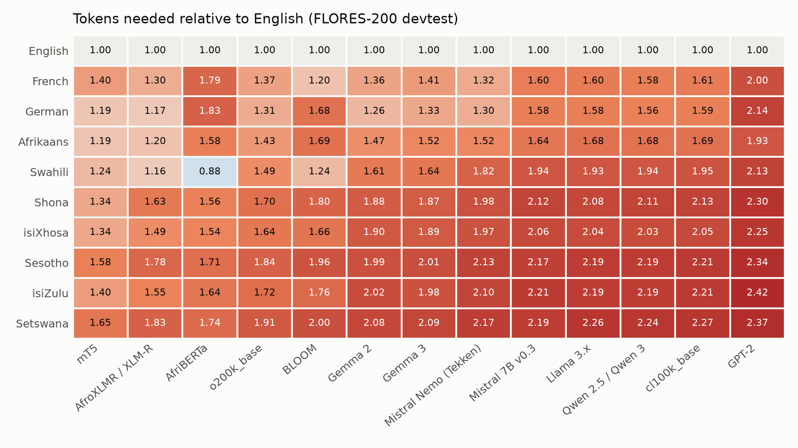
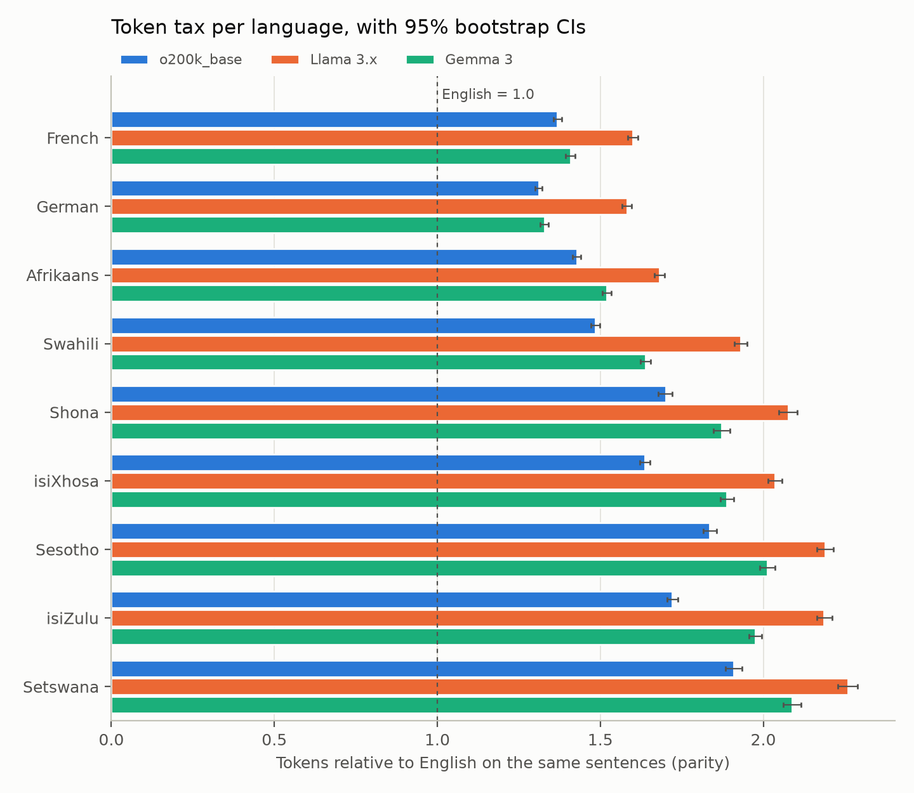
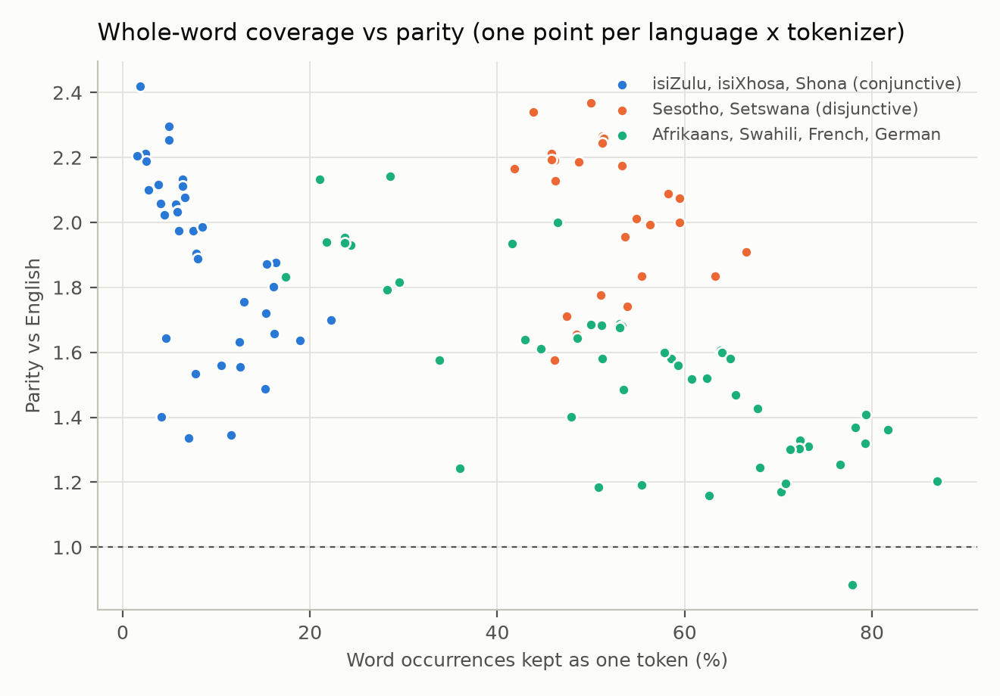

# The token tax: what Southern African languages cost in modern tokenizers

How many more tokens does the same sentence need in isiZulu, isiXhosa, Sesotho, Setswana,
Shona, Swahili or Afrikaans than in English, across 15 open tokenizers? And what does that
mean for price, context length and latency?

**Short answer.** On 1,012 parallel FLORES-200 sentences, isiZulu, isiXhosa, Sesotho,
Setswana and Shona need 1.6 to 2.3 times as many tokens as English with the tokenizers
behind GPT-4o, GPT-4, Llama 3, Qwen, Gemma and Mistral. With GPT-4o's `o200k_base`,
isiZulu needs 1.72x [95% CI 1.70, 1.74] and Setswana 1.91x [1.88, 1.93]. With Llama 3
the figures are 2.19x and 2.26x. At an equal per-token price, the same request costs
that much more, and an 8k context holds 40% to 55% fewer sentences.



## 1. Question

For a fixed piece of content, how many tokens does each language need relative to
English (the *parity* ratio of Petrov et al., 2023), for the tokenizers behind current
open and commercial models? Which languages pay the most, which tokenizers charge the
least, and is the gap explained by how much of each language's vocabulary the tokenizer
stores as whole words?

## 2. Why it matters

Language models read and write tokens, not words. Three things scale with token count:

- **Price.** Hosted APIs bill per token. If a language needs 2x the tokens, a user pays
  2x for the same request (Ahia et al., 2023).
- **Context.** A fixed context window holds fewer sentences, so less document, chat
  history or retrieved evidence fits.
- **Latency.** Generation emits one token per step, so a reply that needs 2x the tokens
  takes roughly 2x as long to stream at the same tokens-per-second. (Latency is not
  measured here. It follows from token counts only if the per-token speed is the same.)

isiZulu, isiXhosa, Sesotho, Setswana, Shona and Afrikaans are official or national
languages for tens of millions of people in South Africa, Zimbabwe, Lesotho and Botswana,
and Swahili is a lingua franca across East Africa. These users already pay more and get
less context, before any difference in model quality is considered.

## 3. Method

### Data

FLORES-200 `devtest` (NLLB Team, 2022): 1,012 English sentences from Wikinews,
Wikijunior and Wikivoyage, each translated professionally into every language. Because
the content is the same across languages, the token count ratio measures the tokenizer
and the language, not the topic.

The official Hugging Face copies (`openlanguagedata/flores_plus`, `facebook/flores`) are
gated behind a login. To keep the study reproducible without an account, the data comes
from the public `mteb/flores` mirror of the same devtest split, pinned to revision
`69edd33`. The download script checks that all 1,012 rows are present and non-empty for
every language.

| code | language | FLORES column | role |
| :-- | :-- | :-- | :-- |
| eng | English | `eng_Latn` | baseline |
| fra, deu | French, German | `fra_Latn`, `deu_Latn` | European reference points |
| afr | Afrikaans | `afr_Latn` | Southern African, Germanic |
| zul, xho | isiZulu, isiXhosa | `zul_Latn`, `xho_Latn` | Nguni (Bantu), written conjunctively |
| sot, tsn | Sesotho, Setswana | `sot_Latn`, `tsn_Latn` | Sotho-Tswana (Bantu), written disjunctively |
| sna | Shona | `sna_Latn` | Bantu, written conjunctively |
| swh | Swahili | `swh_Latn` | Bantu, East African lingua franca |

### Tokenizers

Only tokenizer files are downloaded (no model weights), anonymously, at pinned
revisions (see [`configs/experiment.yaml`](configs/experiment.yaml)). Special tokens
(BOS, EOS, CLS) are not counted.

| tokenizer | source (repo@revision) | vocab | notes |
| :-- | :-- | --: | :-- |
| GPT-2 | `openai-community/gpt2@607a30d` | 50,257 | historical reference |
| cl100k_base | `tiktoken:cl100k_base` | 100,277 | GPT-4 / GPT-3.5 |
| o200k_base | `tiktoken:o200k_base` | 200,019 | GPT-4o family |
| Llama 3.x | `unsloth/Llama-3.2-1B-Instruct@5a8abab` | 128,256 | ungated mirror, upstream is gated |
| Qwen 2.5 | `Qwen/Qwen2.5-7B-Instruct@a09a354` | 151,665 | |
| Qwen 3 | `Qwen/Qwen3-8B@b968826` | 151,669 | identical counts to Qwen 2.5 |
| Gemma 2 | `unsloth/gemma-2-2b-it@457f2e1` | 256,000 | ungated mirror, upstream is gated |
| Gemma 3 | `unsloth/gemma-3-1b-it@5b11413` | 262,145 | ungated mirror, upstream is gated |
| Mistral 7B v0.3 | `mistralai/Mistral-7B-Instruct-v0.3@c170c70` | 32,768 | SentencePiece |
| Mistral Nemo (Tekken) | `mistralai/Mistral-Nemo-Instruct-2407@04d8a90` | 131,072 | |
| BLOOM | `bigscience/bloom@7f10a99` | 250,680 | training data included some Niger-Congo languages |
| mT5 | `google/mt5-base@2eb1546` | 250,100 | mC4, 101 languages |
| XLM-R | `FacebookAI/xlm-roberta-base@e73636d` | 250,002 | CC-100, 100 languages |
| AfroXLMR | `Davlan/afro-xlmr-base@25f2729` | 250,002 | identical counts to XLM-R |
| AfriBERTa | `castorini/afriberta_large@231d924` | 70,006 | African languages only, no English |

Skipped or substituted:

| repo | reason |
| :-- | :-- |
| `meta-llama/Llama-3.2-1B-Instruct` | gated (manual approval); measured through the unsloth mirror |
| `google/gemma-2-2b-it`, `google/gemma-3-1b-it` | gated (manual approval); measured through unsloth mirrors |
| `lelapa/InkubaLM-0.4B` | gated (login required); no ungated copy found, so not measured |

Two pairs gave exactly the same count on all 10,120 sentence-language pairs: Qwen 3 =
Qwen 2.5, and AfroXLMR = XLM-R. AfroXLMR adapted XLM-R's weights to African languages
but kept its tokenizer, so it pays the same token tax. When results are pooled across
tokenizers, each pair counts once (13 distinct tokenizers).

### Metrics

For each language L and tokenizer T, over the same 1,012 sentences:

| metric | definition |
| :-- | :-- |
| tokens per sentence | mean token count |
| fertility | total tokens / total whitespace-separated words (Rust et al., 2021) |
| characters per token | total Unicode characters / total tokens |
| bytes per token | total UTF-8 bytes / total tokens |
| **parity** | total tokens in L / total tokens in English, on the same sentences (Petrov et al., 2023) |
| cost multiplier | equals parity when the price per token is the same for every language |
| sentences in 8k | floor(8192 / mean tokens per sentence) |
| English-token equivalent of 8k | floor(8192 / parity): how much English-sized content fits |

Rates are ratios of sums, not means of per-sentence ratios. This is what a user is
billed on, and it is not dominated by short sentences.

**Uncertainty.** 95% percentile bootstrap intervals over sentences, with 2,000 resamples
and seed 20231. One set of resampled sentence indices is drawn once and reused for
every language and tokenizer, so each parity ratio compares the *same* resampled
sentences in L and in English (a paired bootstrap). Running `make all` twice gives
byte-identical results.

**Decomposition.** Parity splits exactly into two factors:

```
parity = (chars_L / chars_en)  x  (chars-per-token_en / chars-per-token_L)
       =  length ratio         x  compression gap
```

The length ratio belongs to the translation and does not depend on the tokenizer. The
compression gap is how much worse the tokenizer packs this language than English.

**Vocabulary coverage.** Each word type (punctuation stripped, at least one letter) is
encoded on its own, with the same word-boundary marker it would get mid-sentence. The
*single-token rate* is the share of word occurrences that come out as exactly one token.
As a check, encoding every raw whitespace word on its own reproduces 97.6% to 100% of the
sentence-level token count for every tokenizer and language
([`results/sanity_word_sums.csv`](results/sanity_word_sums.csv)).

## 4. Results

### 4.1 Parity with 95% CIs (o200k_base, the GPT-4o tokenizer)

| language | tokens/sentence | fertility | chars/token | bytes/token | parity (= cost x) | sentences in 8k | English-token equivalent of 8k |
| :-- | --: | --: | --: | --: | --: | --: | --: |
| English | 26.6 [26.0, 27.1] | 1.23 [1.22, 1.24] | 4.91 [4.87, 4.95] | 4.92 [4.88, 4.96] | 1.00 | 308 [302, 314] | 8192 |
| French | 36.3 [35.6, 37.1] | 1.43 [1.42, 1.44] | 4.29 [4.25, 4.32] | 4.46 [4.42, 4.49] | 1.37 [1.36, 1.38] | 225 [220, 230] | 5988 |
| German | 34.8 [34.1, 35.6] | 1.62 [1.61, 1.63] | 4.37 [4.34, 4.40] | 4.44 [4.41, 4.47] | 1.31 [1.30, 1.32] | 235 [230, 240] | 6249 |
| Afrikaans | 37.9 [37.1, 38.7] | 1.66 [1.65, 1.68] | 3.64 [3.62, 3.66] | 3.68 [3.66, 3.70] | 1.43 [1.42, 1.44] | 216 [211, 220] | 5738 |
| Swahili | 39.4 [38.7, 40.3] | 1.88 [1.86, 1.89] | 3.46 [3.44, 3.48] | 3.46 [3.45, 3.48] | 1.49 [1.47, 1.50] | 207 [203, 211] | 5514 |
| Shona | 45.1 [44.2, 46.1] | 2.63 [2.61, 2.65] | 3.23 [3.22, 3.25] | 3.23 [3.22, 3.25] | 1.70 [1.68, 1.72] | 181 [177, 185] | 4818 |
| isiXhosa | 43.5 [42.6, 44.4] | 2.84 [2.82, 2.86] | 3.16 [3.15, 3.18] | 3.17 [3.15, 3.18] | 1.64 [1.62, 1.65] | 188 [184, 192] | 5004 |
| Sesotho | 48.7 [47.8, 49.8] | 1.71 [1.70, 1.72] | 3.22 [3.21, 3.23] | 3.22 [3.21, 3.24] | 1.84 [1.81, 1.86] | 168 [164, 171] | 4463 |
| isiZulu | 45.7 [44.8, 46.7] | 2.92 [2.90, 2.94] | 3.21 [3.19, 3.22] | 3.21 [3.20, 3.23] | 1.72 [1.70, 1.74] | 179 [175, 183] | 4761 |
| Setswana | 50.7 [49.7, 51.8] | 1.66 [1.65, 1.68] | 3.18 [3.17, 3.19] | 3.18 [3.17, 3.19] | 1.91 [1.88, 1.93] | 161 [158, 164] | 4291 |

The same table for Llama 3.x and Gemma 3 is in
[`results/metrics_llama3.md`](results/metrics_llama3.md) and
[`results/metrics_gemma3.md`](results/metrics_gemma3.md). Every metric for every pair,
with CI bounds, is in [`results/metrics.csv`](results/metrics.csv).

### 4.2 Parity across all tokenizers

Columns are sorted by mean parity over the seven Southern African languages, and rows by
median parity. All CIs are narrow (half-width 0.032 or less; see `metrics.csv`).

| language | mT5 | AfroXLMR | XLM-R | AfriBERTa | o200k_base | BLOOM | Gemma 2 | Gemma 3 | Mistral Nemo | Mistral 7B v0.3 | Llama 3.x | Qwen 2.5 | Qwen 3 | cl100k_base | GPT-2 |
| :-- | --: | --: | --: | --: | --: | --: | --: | --: | --: | --: | --: | --: | --: | --: | --: |
| French | 1.40 | 1.30 | 1.30 | 1.79 | 1.37 | 1.20 | 1.36 | 1.41 | 1.32 | 1.60 | 1.60 | 1.58 | 1.58 | 1.61 | 2.00 |
| German | 1.19 | 1.17 | 1.17 | 1.83 | 1.31 | 1.68 | 1.26 | 1.33 | 1.30 | 1.58 | 1.58 | 1.56 | 1.56 | 1.59 | 2.14 |
| Afrikaans | 1.19 | 1.20 | 1.20 | 1.58 | 1.43 | 1.69 | 1.47 | 1.52 | 1.52 | 1.64 | 1.68 | 1.68 | 1.68 | 1.69 | 1.93 |
| Swahili | 1.24 | 1.16 | 1.16 | 0.88 | 1.49 | 1.24 | 1.61 | 1.64 | 1.82 | 1.94 | 1.93 | 1.94 | 1.94 | 1.95 | 2.13 |
| Shona | 1.34 | 1.63 | 1.63 | 1.56 | 1.70 | 1.80 | 1.88 | 1.87 | 1.98 | 2.12 | 2.08 | 2.11 | 2.11 | 2.13 | 2.30 |
| isiXhosa | 1.34 | 1.49 | 1.49 | 1.54 | 1.64 | 1.66 | 1.90 | 1.89 | 1.97 | 2.06 | 2.04 | 2.03 | 2.03 | 2.05 | 2.25 |
| Sesotho | 1.58 | 1.78 | 1.78 | 1.71 | 1.84 | 1.96 | 1.99 | 2.01 | 2.13 | 2.17 | 2.19 | 2.19 | 2.19 | 2.21 | 2.34 |
| isiZulu | 1.40 | 1.55 | 1.55 | 1.64 | 1.72 | 1.76 | 2.02 | 1.98 | 2.10 | 2.21 | 2.19 | 2.19 | 2.19 | 2.21 | 2.42 |
| Setswana | 1.65 | 1.83 | 1.83 | 1.74 | 1.91 | 2.00 | 2.08 | 2.09 | 2.17 | 2.19 | 2.26 | 2.24 | 2.24 | 2.27 | 2.37 |



### 4.3 Parity is relative: absolute tokens per sentence

A low parity can come from spending *more* tokens on English. mT5, XLM-R and AfriBERTa
use 30 to 35 tokens for an average English sentence, where the GPT, Llama, Qwen and Gemma
tokenizers use 27. In absolute terms, `o200k_base` needs the fewest tokens for isiZulu,
isiXhosa, Sesotho and Setswana, and is within 0.2 tokens of mT5 for Shona
([`results/tokens_per_sentence.md`](results/tokens_per_sentence.md)):

| language | mT5 | XLM-R | AfriBERTa | o200k_base | BLOOM | Gemma 3 | Llama 3.x | Qwen 2.5 | Mistral 7B v0.3 |
| :-- | --: | --: | --: | --: | --: | --: | --: | --: | --: |
| English | 33.4 | 30.3 | 35.4 | 26.6 | 27.1 | 26.8 | 26.8 | 27.3 | 29.6 |
| Swahili | 41.5 | 35.2 | 31.3 | 39.4 | 33.7 | 43.9 | 51.8 | 52.8 | 57.5 |
| Shona | 44.9 | 49.4 | 55.3 | 45.1 | 48.8 | 50.2 | 55.8 | 57.7 | 62.7 |
| isiXhosa | 44.6 | 45.1 | 54.4 | 43.5 | 44.9 | 50.6 | 54.7 | 55.5 | 61.0 |
| isiZulu | 46.8 | 47.1 | 58.3 | 45.7 | 47.6 | 52.9 | 58.7 | 59.7 | 65.4 |
| Sesotho | 52.6 | 53.8 | 60.6 | 48.7 | 53.0 | 53.9 | 58.8 | 59.9 | 64.2 |
| Setswana | 55.2 | 55.6 | 61.7 | 50.7 | 54.2 | 55.9 | 60.7 | 61.2 | 64.8 |

### 4.4 Where the tax comes from: text length vs compression

| language | length ratio (chars vs English) | compression gap, o200k_base | compression gap, Llama 3.x | compression gap, Gemma 3 |
| :-- | --: | --: | --: | --: |
| French | 1.19 | 1.15 | 1.34 | 1.18 |
| German | 1.17 | 1.12 | 1.36 | 1.14 |
| Afrikaans | 1.06 | 1.35 | 1.59 | 1.44 |
| Swahili | 1.05 | 1.42 | 1.84 | 1.57 |
| Shona | 1.12 | 1.52 | 1.86 | 1.67 |
| isiXhosa | 1.05 | 1.55 | 1.93 | 1.79 |
| Sesotho | 1.20 | 1.53 | 1.82 | 1.67 |
| isiZulu | 1.12 | 1.53 | 1.94 | 1.76 |
| Setswana | 1.24 | 1.55 | 1.83 | 1.69 |

The Southern African translations are only about 5% to 24% longer than English in
characters. Most of the tax is compression: `o200k_base` packs 4.91 characters into an
English token but only 3.16 to 3.23 into an isiZulu, isiXhosa, Sesotho, Setswana or
Shona token. For French and German the two factors are about
equal and both small.

### 4.5 Vocabulary coverage and morphology

Share of word occurrences that the tokenizer keeps as a single token
([`results/coverage.md`](results/coverage.md)), for a selection of tokenizers:

| language | mT5 | XLM-R | o200k_base | BLOOM | Gemma 3 | Llama 3.x | Mistral 7B v0.3 |
| :-- | --: | --: | --: | --: | --: | --: | --: |
| English | 64% | 79% | 94% | 91% | 95% | 93% | 86% |
| Afrikaans | 55% | 71% | 68% | 50% | 62% | 53% | 49% |
| Swahili | 36% | 63% | 53% | 68% | 43% | 24% | 22% |
| Shona | 12% | 12% | 22% | 16% | 15% | 7% | 4% |
| isiXhosa | 7% | 15% | 19% | 16% | 8% | 6% | 4% |
| isiZulu | 4% | 13% | 15% | 13% | 8% | 3% | 2% |
| Sesotho | 46% | 51% | 63% | 54% | 55% | 46% | 42% |
| Setswana | 48% | 55% | 67% | 59% | 58% | 51% | 49% |



Across 9 non-English languages and 13 distinct tokenizers (117 points), single-token
rate and parity have Spearman rho = -0.52 (Pearson r with log parity = -0.51). The
pooled number hides the structure in the scatter, though: the two Sotho-Tswana languages
sit far to the right of the Nguni languages and Shona at the same parity. A cleaner test
holds the language fixed and varies the tokenizer. Within each language, across the 13
tokenizers, the median Spearman rho is -0.73 (range -0.93 for Swahili to -0.37 for
Setswana). In other words, a tokenizer that stores more of a language's words whole
also charges less for that language.

**Orthography matters.** isiZulu, isiXhosa and Shona are written *conjunctively*: noun
class prefixes, subject and object markers and tense affixes are joined into one long
word. Sesotho and Setswana are written *disjunctively*: many of the same elements are
separate short words. As a result, Sesotho and Setswana have a whitespace fertility
(1.66 to 1.71 with `o200k_base`) close to Afrikaans, and almost half their word
occurrences are single tokens, yet they have the highest parity of all. Whitespace
fertility and single-token rate therefore cannot be compared across these orthographies,
while parity on parallel text can.

**What happens to long conjunctive words.** These are the longest recurring
(frequency >= 2, lowercase, >= 12 characters) isiZulu and isiXhosa words in the
devtest, chosen automatically by their `o200k_base` token count
([`results/morphology_examples.md`](results/morphology_examples.md)). The morpheme
breakdowns are my own approximate analyses, added for reading the table. They are not
produced by the code.

| language | word | approx. morphemes and gloss | o200k_base | Llama 3.x | AfroXLMR / XLM-R | mT5 |
| :-- | :-- | :-- | :-- | :-- | :-- | :-- |
| isiZulu | njengenhlokodolobha | njenge-in-hloko-dolobha "as the capital city" (head-town) | 7: nj·engen·hl·ok·odol·ob·ha | 8: nj·eng·enh·lok·od·ol·ob·ha | 6: njenge·nh·loko·do·lo·bha | 5: njenge·n·hloko·dol·obha |
| isiZulu | okungokwezobuchwepheshe | oku-ngo-kwe-zo-bu-chwepheshe "which concerns technical matters" | 7: ok·ung·ok·wez·ob·uch·wepheshe | 11: ok·ung·ok·we·z·ob·uch·w·ep·hes·he | 8: oku·ngo·kwe·zo·buch·we·phe·she | 7: okun·go·kwez·o·buch·wep·heshe |
| isiZulu | inhlokodolobha | in-hloko-dolobha "capital city" | 6: in·hl·ok·odol·ob·ha | 6: inh·lok·od·ol·ob·ha | 5: in·hlo·kod·olo·bha | 4: in·hloko·dol·obha |
| isiZulu | yesishiyagalolunye | ye-si-shiyagalolunye "of the ninth / of nine" | 6: yes·ish·iy·agal·ol·unye | 7: yes·ish·iy·agal·ol·un·ye | 6: yes·is·hiya·gal·olu·nye | 5: yes·ish·iyaga·lol·unye |
| isiXhosa | yiriphabliki | yi-i-riphabliki "it is a republic" | 6: y·ir·ip·hab·l·iki | 6: y·ir·ip·hab·li·ki | 4: yiri·pha·blik·i | 5: ▁·yiri·pha·blik·i |
| isiXhosa | ezisetyenziswayo | ezi-setyenzis-w-a-yo "which are used" | 6: ez·is·ety·enz·is·wayo | 7: ez·is·ety·enz·is·way·o | 6: ez·iset·yen·zis·way·o | 3: ezi·setyenziswa·yo |
| isiXhosa | elingabonakaliyo | eli-nga-bonakal-i-yo "which is not visible" | 6: el·ing·abon·ak·ali·yo | 7: el·ing·ab·on·ak·ali·yo | 5: el·inga·bona·ka·liyo | 5: el·ing·a·bonakal·iyo |
| isiXhosa | esibhakabhakeni | e-isibhakabhaka-eni "in the sky" | 6: es·ibh·ak·abh·ak·eni | 7: es·ib·h·ak·abh·aken·i | 5: esi·bha·kab·hake·ni | 5: es·ibh·ak·abha·keni |

No tokenizer splits on morpheme boundaries. The byte-level BPE vocabularies (o200k_base,
Llama 3) break these words into two- and three-letter fragments such as `hl·ok·odol·ob`
that cross the boundary between *hloko* "head" and *dolobha* "town". The
SentencePiece vocabularies trained on more multilingual data (mT5, XLM-R) more often
keep a stem or a prefix intact (`hloko`, `njenge`, `setyenziswa`), which is why their
compression gap for these languages is smaller.

## 5. Findings in plain words

1. **Every Southern African language pays a tax under every tokenizer tested**, except
   Swahili under AfriBERTa (0.88), whose vocabulary was built without English. With
   the tokenizers behind GPT-4o, Llama 3, Qwen, Gemma and Mistral, isiZulu, isiXhosa,
   Sesotho, Setswana and Shona need 1.64x (isiXhosa, o200k_base) to 2.26x (Setswana,
   Llama 3) as many tokens as English.
2. **GPT-4o's `o200k_base` is the cheapest of the LLM tokenizers tested for these
   languages.** It uses the fewest absolute tokens for isiZulu, isiXhosa, Sesotho and
   Setswana. Its parity is still 1.64 to 1.91 for these five Bantu languages, compared
   with 1.31 to 1.37 for French and German.
3. **Larger vocabularies helped, but the training mix helped more.** Going from GPT-2
   (50k) to cl100k (100k) to o200k (200k) lowered isiZulu parity from 2.42 to 2.21 to
   1.72. But Llama 3 (128k), Qwen 2.5/3 (152k) and Mistral Nemo (131k) have about the
   same vocabulary size as cl100k and about the same tax (2.10 to 2.19 for isiZulu), and
   Gemma 2/3 (256k to 262k) still sits at about 2.0.
4. **In practice the tax means paying about 1.6x to 2.3x as much and fitting 40% to 55%
   fewer sentences in the context.** At an equal per-token price, an isiZulu request costs 1.72x
   [1.70, 1.74] as much as the English one with o200k_base and 2.19x [2.16, 2.21] with
   Llama 3. An 8k window holds about 308 English sentences but 179 isiZulu and 161
   Setswana sentences with o200k_base. With Llama 3 it holds 139 isiZulu and 135
   Setswana sentences.
5. **Africa-focused models do not automatically have Africa-focused tokenizers.**
   AfroXLMR gives exactly the same counts as XLM-R. AfriBERTa does well on Swahili,
   which it was trained on, but needs more absolute tokens than o200k_base for every
   other language in the study.
6. **Coverage tracks cost within a language.** The more of a language's words a
   tokenizer stores whole, the lower its tax (median within-language Spearman rho
   -0.73). Comparisons *between* languages must account for orthography: disjunctive
   Sesotho and Setswana look well covered word by word but are the most expensive per
   sentence.

## 6. Limitations

- **One domain, translated text.** FLORES is formal, translated from English, and drawn
  from encyclopaedic and travel text. Conversational, code-switched or social media
  text (common in South Africa) may tokenize differently, and translationese may be
  shorter or longer than natively written text.
- **Mirrors.** The data comes from `mteb/flores`, and the Llama and Gemma tokenizers
  from unsloth mirrors, because the official repos are gated. I checked that the
  mirrors load and have the expected vocabulary sizes, but did not compare them byte by
  byte with the gated originals.
- **Whitespace fertility is crude.** It depends on orthography (conjunctive vs
  disjunctive writing) as much as on the tokenizer, as shown in 4.5. Parity on parallel
  text avoids this problem but has one of its own: it is relative to the tokenizer's own
  English, so it needs to be read together with absolute counts (4.3).
- **Coverage measure.** Encoding words in isolation approximates in-context
  tokenization (97.6% to 100% agreement in total counts) but is not identical. The
  correlations are descriptive, over few languages, and not causal.
- **Open tokenizers only.** Several commercial models do not publish their tokenizers,
  so they are not measured. Real API prices also differ by model and sometimes by input
  vs output, so "cost multiplier" assumes one price per token.
- **Latency is inferred, not measured.** The latency claim assumes equal per-token
  speed.
- **Coverage of the language list.** InkubaLM, a model built for African languages,
  could not be measured because its repository is gated.
- **Morpheme glosses** in 4.5 are approximate and were added by hand. They are for
  illustration and are not used in any computation.

## 7. Reproduce

Requirements: [uv](https://docs.astral.sh/uv/) and Python 3.12. No API keys or
Hugging Face login are needed. Downloads total about 15 MB of data plus tokenizer files.
The full pipeline takes about 3 minutes on an M1 Max laptop.

```bash
uv sync
make data      # FLORES-200 devtest -> data/ (not committed)
make measure   # token counts for every sentence and word type -> data/
make report    # tables, figures, summary.json -> results/
make check     # ruff, mypy --strict, pytest
```

`make all` runs the first three steps. Tokenizer revisions, languages, bootstrap settings
and headline tokenizers are set in [`configs/experiment.yaml`](configs/experiment.yaml).
`tiktoken` encodings are pinned by the `tiktoken` version in `uv.lock`, which checks the
encoding file's SHA-256 on download.

```
configs/experiment.yaml   pinned dataset and tokenizer revisions, analysis settings
src/token_tax/
  config.py               typed config loader
  data.py                 download and validate FLORES-200 devtest
  tokenization.py         one interface over Hugging Face and tiktoken tokenizers
  measure.py              per-sentence and per-word token counts
  metrics.py              pure metric functions (bootstrap, parity, correlation)
  analysis.py             tables from counts
  figures.py, report.py   PNG figures and Markdown/CSV tables
  cli.py                  `token-tax {data,measure,report,all}`
tests/                    pytest suite for metrics and analysis helpers
results/                  committed outputs (small CSV, Markdown, PNG, JSON)
```

## 8. References

- Petrov, A., La Malfa, E., Torr, P. H. S., and Bibi, A. (2023). Language Model
  Tokenizers Introduce Unfairness Between Languages. *NeurIPS 2023*.
  [arXiv:2305.15425](https://arxiv.org/abs/2305.15425)
- Ahia, O., Kumar, S., Gonen, H., Kasai, J., Mortensen, D. R., Smith, N. A., and
  Tsvetkov, Y. (2023). Do All Languages Cost the Same? Tokenization in the Era of
  Commercial Language Models. *EMNLP 2023*.
  [arXiv:2305.13707](https://arxiv.org/abs/2305.13707)
- Rust, P., Pfeiffer, J., Vulić, I., Ruder, S., and Gurevych, I. (2021). How Good is Your
  Tokenizer? On the Monolingual Performance of Multilingual Language Models. *ACL 2021*.
  [arXiv:2012.15613](https://arxiv.org/abs/2012.15613)
- NLLB Team (2022). No Language Left Behind: Scaling Human-Centered Machine Translation.
  [arXiv:2207.04672](https://arxiv.org/abs/2207.04672) (FLORES-200)
- Goyal, N., et al. (2022). The FLORES-101 Evaluation Benchmark for Low-Resource and
  Multilingual Machine Translation. *TACL*.
  [arXiv:2106.03193](https://arxiv.org/abs/2106.03193)
- Alabi, J. O., Adelani, D. I., Mosbach, M., and Klakow, D. (2022). Adapting Pre-trained
  Language Models to African Languages via Multilingual Adaptive Fine-Tuning.
  *COLING 2022*. [arXiv:2204.06487](https://arxiv.org/abs/2204.06487) (AfroXLMR)
- Ogueji, K., Zhu, Y., and Lin, J. (2021). Small Data? No Problem! Exploring the
  Viability of Pretrained Multilingual Language Models for Low-resourced Languages.
  *MRL Workshop 2021*. [ACL Anthology](https://aclanthology.org/2021.mrl-1.11/) (AfriBERTa)
- Xue, L., et al. (2021). mT5: A Massively Multilingual Pre-trained Text-to-Text
  Transformer. *NAACL 2021*. [arXiv:2010.11934](https://arxiv.org/abs/2010.11934)
- Conneau, A., et al. (2020). Unsupervised Cross-lingual Representation Learning at
  Scale. *ACL 2020*. [arXiv:1911.02116](https://arxiv.org/abs/1911.02116) (XLM-R)

## Licence

Code: [Apache-2.0](LICENSE). Data: FLORES-200 is released under
[CC-BY-SA 4.0](https://creativecommons.org/licenses/by-sa/4.0/). It is downloaded by
`make data` and not committed. The committed results contain aggregate statistics and
the eight example words in section 4.5, which are quoted from FLORES-200 under the same
licence.
